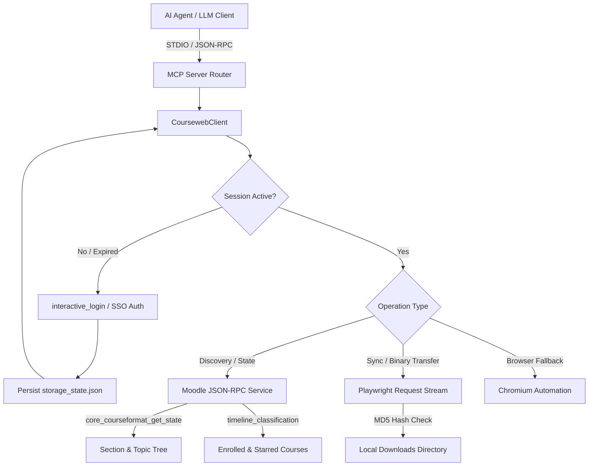

<p align="center">
  <a href="https://sliitcoursewebmcp.kesaru.me" target="_blank" rel="noopener noreferrer">
    
  </a>
</p>

<h1 align="center">SLIIT Courseweb MCP Server</h1>

<p align="center">
  High-performance Model Context Protocol (MCP) server connecting LLM agents to SLIIT Courseweb (Moodle LMS) for automated material synchronization, course discovery, and deadline tracking.
</p>

<p align="center">
  <a href="https://www.typescriptlang.org"></a>
  <a href="https://modelcontextprotocol.io"></a>
  <a href="https://nodejs.org"></a>
  <a href="LICENSE"></a>
</p>

<p align="center">
  <a href="#overview">Overview</a> &bull;
  <a href="#architecture">Architecture</a> &bull;
  <a href="#project-structure">Structure</a> &bull;
  <a href="#installation">Installation</a> &bull;
  <a href="#usage">Usage</a> &bull;
  <a href="#tools-reference">Tools</a> &bull;
  <a href="#verification-tests">Testing</a> &bull;
  <a href="#security--privacy">Security</a> &bull;
  <a href="#license">License</a>
</p>

---

## Overview

The SLIIT Courseweb MCP server bridges AI coding agents (including Google Antigravity, Claude Code, Cursor, and OpenAI Codex) directly into SLIIT's Moodle-based academic portal (`courseweb.sliit.lk`).

Modern Moodle installations dynamically render courses using asynchronous plugins such as `format_tiles` and `format_grid`. Traditional DOM scrapers fail because non-active sections and topics remain unmounted placeholders in the initial HTML. This server implements a hybrid architecture: it communicates directly with Moodle's authenticated JSON-RPC web service (`core_courseformat_get_state`, `core_course_get_enrolled_courses_by_timeline_classification`, and `core_get_fragment`) for sub-second retrieval, while retaining a Playwright-backed headless browser fallback for SSO authentication, MFA sessions, and WAF protection bypass.

---

## Architecture

The server operates through a dual-channel execution pipeline optimized for speed and resilience against Cloudflare/Imperva Web Application Firewalls:

| Feature | Direct Web Service RPC | Headless Browser Engine |
| :--- | :--- | :--- |
| **Primary Use** | Course listing, state inspection, file downloads | SSO login, interactive MFA, complex form evaluation |
| **Latency Profile** | 200ms - 600ms per request | 2s - 10s per navigation |
| **Course Formats** | Full support (`format_tiles`, `format_topics`, `format_weeks`) | Fallback DOM parsing |
| **WAF Resilience** | Automatic `forcedownload=1` and trailing slash retry | Native Chromium cookie and header handling |
| **Resource Footprint** | Minimal (Node.js HTTP client) | Moderate (Headless Chromium instance) |



---

## Project Structure

```
.
├── src/
│   ├── index.ts              # MCP server definition, schema validation, and request dispatcher
│   └── courseweb.ts          # Core Moodle client, RPC transport, and Playwright session manager
├── assets/                   # Visual assets and documentation diagrams
├── build/                    # Compiled JavaScript distribution output
├── storage_state.json        # Authenticated session cookies (git-ignored)
├── package.json              # Project dependencies and compilation scripts
├── tsconfig.json             # TypeScript compiler configuration
└── README.md                 # Technical specification and documentation
```

---

## Installation

### Prerequisites

- Node.js 18.0.0 or higher
- npm 9.0.0 or higher
- Google Chrome or Chromium installed on the host system

### Setup Steps

1. Clone the repository:
   ```bash
   git clone https://github.com/kesaruhasun/mcp-sliit-courseweb.git
   cd mcp-sliit-courseweb
   ```

2. Install dependencies:
   ```bash
   npm install
   ```

3. Compile TypeScript sources:
   ```bash
   npm run build
   ```

---

## Usage

### Agent Configuration

#### Google Antigravity

Add the server definition to `~/.gemini/config/mcp_config.json`:

```json
{
  "mcpServers": {
    "sliit-courseweb": {
      "command": "node",
      "args": [
        "/absolute/path/to/mcp-sliit-courseweb/build/index.js"
      ],
      "disabled": false
    }
  }
}
```

#### Claude Code CLI

Add the server using the Claude CLI registry command:

```bash
claude mcp add sliit-courseweb node "/absolute/path/to/mcp-sliit-courseweb/build/index.js" -e HEADLESS=true
```

#### Cursor & Windsurf

Add to your project's `.cursor/mcp.json` or global MCP settings:

```json
{
  "mcpServers": {
    "sliit-courseweb": {
      "command": "node",
      "args": ["/absolute/path/to/mcp-sliit-courseweb/build/index.js"]
    }
  }
}
```

### Authentication Workflow

1. **Interactive Login (Recommended for MFA)**:
   Call the `interactive_login` tool. A browser window opens for SLIIT Microsoft 365 SSO and MFA verification. Once complete, credentials are automatically captured and saved to `storage_state.json`.

2. **Direct Cookie Injection (Headless / Remote Servers)**:
   If running on a remote headless VM, obtain your `MoodleSession` cookie value from browser developer tools and pass it to `set_session_cookie`:
   ```bash
   # Parameter: value="t8egaudc5h2b0t4v01ridbnvlc"
   ```

---

## Tools Reference

| Tool Name | Parameters | Description |
| :--- | :--- | :--- |
| `list_modules` | `filter?: "all" \| "starred" \| "favourites" \| "inprogress" \| "past" \| "future"` | Lists enrolled modules with metadata (`id`, `name`, `shortname`, `isStarred`, `category`). |
| `check_module_updates` | `courseId: string` | Retrieves complete section breakdown, activities, lecture slides, meeting URLs, and embedded links. |
| `sync_module` | `courseId: string`, `outputDir?: string`, `organizeBySection?: boolean` | Bulk downloads all lecture slides, tutorials, attendance records, and nested folders with MD5 deduplication. |
| `download_file` | `url: string`, `outputDir?: string`, `customFilename?: string` | Downloads a specific resource file with automatic Content-Disposition extraction and WAF retry. |
| `get_folder_contents` | `url: string` | Inspects and enumerates all downloadable files within a `mod_folder` container. |
| `get_announcements` | None | Scrapes general university and site announcements from the central forum. |
| `get_deadlines` | None | Fetches upcoming assignment cutoffs and calendar events. |
| `check_assignment_status` | `url: string` | Checks grading status, submission state, and feedback for a given assignment URL. |
| `scrape_page` | `url: string` | Extracts visible text content from any authenticated Courseweb page for layout debugging. |
| `set_session_cookie` | `value: string` | Injects an active `MoodleSession` cookie directly into the session cache. |
| `interactive_login` | None | Launches a GUI browser for Microsoft Azure AD single sign-on and MFA. |

---

## Verification Tests

### Automated Suite

Verify compilation and runtime integrity:

```bash
# Verify TypeScript compilation
npm run build

# Verify MCP server boot on stdio
node build/index.js <<< '{"jsonrpc":"2.0","id":1,"method":"tools/list","params":{}}'
```

### Functional Validation

Test module discovery and starred filtering using Node.js:

```bash
node -e '
import("./build/courseweb.js").then(async ({ CoursewebClient }) => {
  const client = new CoursewebClient();
  await client.init();
  const starred = await client.getEnrolledCourses("starred");
  console.log("Starred Courses:", starred.map(c => c.name));
  await client.close();
});
'
```

---

## Session Logging & Security

- **Credential Isolation**: Authenticated sessions are stored locally in `storage_state.json`. This file is explicitly listed in `.gitignore` and must never be committed to public repositories.
- **Environment Variables**: Optional automated fallback credentials (`SLIIT_USERNAME`, `SLIIT_PASSWORD`) are loaded via `.env`, which is strictly excluded from version control.
- **WAF Protocol**: The client honors Imperva WAF session tokens (`visid_incap_*`, `incap_ses_*`) to prevent IP throttling during bulk file synchronization.

---

## License

This project is licensed under the [MIT License](LICENSE).
