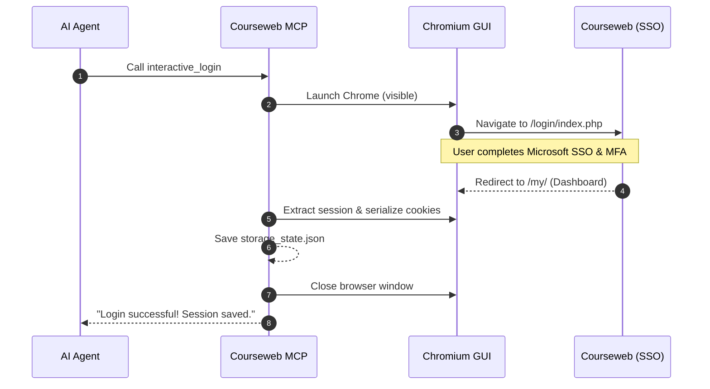

Step-by-step instructions for installing the SLIIT Courseweb MCP Server, establishing authenticated sessions, and connecting to your AI client.

---

## System Prerequisites

Before running the server, verify your local environment satisfies the runtime requirements:

| Component | Minimum Version | Recommended Version | Verification Command |
| :--- | :--- | :--- | :--- |
| **Node.js** | 18.0.0 | 20.x or 22.x LTS | `node -v` |
| **npm** | 9.0.0 | 10.x+ | `npm -v` |
| **Chrome / Chromium** | 115+ | Latest Stable | `google-chrome --version` |
| **Operating System** | Linux, macOS, or Windows (WSL2) | Ubuntu 22.04+ / macOS 14+ | `uname -srm` |

---

## Installation Walkthrough

### 1. Clone the Repository

Clone the repository to your local development environment:

```bash
git clone https://github.com/kesaruhasun/mcp-sliit-courseweb.git
cd mcp-sliit-courseweb
```

### 2. Install Project Dependencies

Install the core dependencies (including the Model Context Protocol SDK, Playwright, and Zod):

```bash
npm install
```

### 3. Build the TypeScript Engine

Compile the TypeScript source files located in `src/` into the runnable JavaScript distribution in `build/`:

```bash
npm run build
```

---

## Authentication Methods

SLIIT Courseweb accounts require Microsoft 365 Single Sign-On (SSO) with Multi-Factor Authentication (MFA). The server provides two distinct authentication pathways depending on your environment.

### Method 1: Interactive Browser Authentication (Recommended)

When working on a local machine with a graphical desktop:

1. Launch your agent (e.g. Claude Code CLI, Cursor, or Google Antigravity).
2. Execute the `interactive_login` tool.
3. Playwright launches a visible Google Chrome window directing you to Microsoft's login gateway:
   - Enter your university email address (`itXXXXXX@my.sliit.lk`).
   - Enter your password and approve the notification on your authenticator application.
   - The server monitors for the Microsoft "Stay signed in?" (KMSI) dialog and auto-confirms it.
4. Once the browser reaches the Courseweb dashboard (`/my/`), the session cookies are automatically dumped to `storage_state.json`.
5. The browser window closes automatically. All subsequent requests run headlessly in the background.



---

### Method 2: Manual Cookie Injection (Headless VMs & Remote Servers)

For cloud instances, headless servers, or Docker containers where a GUI browser cannot open:

1. Open a desktop browser where you are already signed in to [courseweb.sliit.lk](https://courseweb.sliit.lk).
2. Open Chrome Developer Tools (`Ctrl+Shift+I` or `F12` on Linux/Windows, `Cmd+Option+I` on macOS).
3. Select the **Application** tab, expand **Cookies**, and click on `https://courseweb.sliit.lk`.
4. Locate the cookie named `MoodleSession` and copy its value.

<p align="center">
  
</p>

5. Call the `set_session_cookie` tool with the copied token:
   ```json
   {
     "value": "t8egaudc5h2b0t4v01ridbnvlc"
   }
   ```
6. The session cache is immediately written to `storage_state.json` without opening any browser windows.

---

## Connection Verification

To verify that the MCP server compiles, initializes, and answers protocol requests over standard input/output:

```bash
node build/index.js <<< '{"jsonrpc":"2.0","id":1,"method":"tools/list","params":{}}'
```

Expected output:

```json
Courseweb MCP Server running on stdio
{"result":{"tools":[{"name":"list_modules",...},{"name":"sync_module",...}]},"jsonrpc":"2.0","id":1}
```
