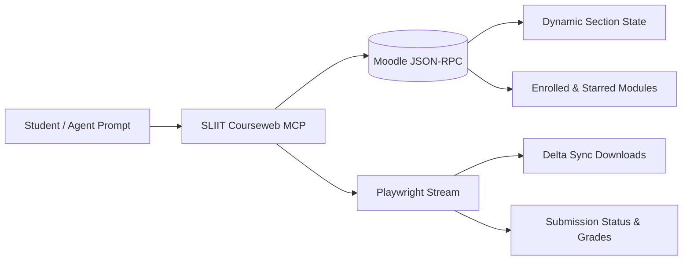

  

  
  
  
  

The **SLIIT Courseweb Model Context Protocol (MCP) Server** is a high-performance integration engine that bridges AI coding assistants directly into SLIIT's Moodle-based academic portal (`courseweb.sliit.lk`). It enables autonomous course synchronization, exam marksheet extraction, and deadline tracking for Google Antigravity, Claude Code, Cursor, Windsurf, and OpenAI Codex.

  

---

## Documentation Navigator

| Guide | Description | Target Audience |
| :--- | :--- | :--- |
| **[[Getting Started|Getting-Started]]** | Complete setup guide covering installation, prerequisites, and authentication workflows. | New users and quick-start |
| **[[Client Configuration|Client-Configuration]]** | Setup instructions for Antigravity, Claude Code CLI, Cursor, Windsurf, and Docker. | Developers configuring AI tools |
| **[[Tool Reference|Tool-Reference]]** | Complete specification for all 11 MCP tools, parameters, schemas, and return formats. | Prompt engineers & LLM agents |
| **[[Moodle Architecture & RPC|Moodle-Architecture-and-RPC]]** | Deep technical breakdown of Moodle 4.x state engines, `format_tiles`, and WAF bypass. | Core contributors & architects |
| **[[Troubleshooting & FAQ|Troubleshooting-and-FAQ]]** | Diagnostic recipes for session expirations, Chromium paths, timeouts, and WAF blocks. | Users resolving edge cases |

---

## Core Capabilities

- **Dynamic Format Parsing**: Native support for modern Moodle layout engines (`format_tiles`, `format_grid`, `format_topics`, and `format_weeks`). Eliminates missing topics by communicating directly with Moodle's reactive state engine.
- **Fast Timeline Filtering**: Identifies ongoing, past, and starred courses in under 500ms using server-side timeline classification.
- **Automated Delta Sync**: Bulk downloads lecture slides, tutorial exercises, and assessment rubrics directly to disk with MD5 deduplication.
- **Recursive Folder Extraction**: Unpacks multi-file `mod_folder` containers into organized local subfolders.
- **WAF Protocol Hardening**: Automatic session token propagation and trailing-slash query fallbacks against Cloudflare and Imperva firewalls.

---

## Supported LLM Environments

- **Google Antigravity**: Configurable via `~/.gemini/config/mcp_config.json`.
- **Claude Code CLI**: Standard STDIO transport with one-command registration (`claude mcp add`).
- **Cursor & Windsurf IDEs**: Configurable via `.cursor/mcp.json`.
- **OpenAI Codex & Custom Agent Frameworks**: Compatible with any standard Model Context Protocol client.

---

## Repository Links

- **Upstream Repository**: [kesaruhasun/mcp-sliit-courseweb](https://github.com/kesaruhasun/mcp-sliit-courseweb)
- **Active Fork**: [dulithdivisekara/mcp-sliit-courseweb](https://github.com/dulithdivisekara/mcp-sliit-courseweb)
- **Latest Release**: [v1.2.0 Release](https://github.com/dulithdivisekara/mcp-sliit-courseweb/releases/tag/v1.2.0)
