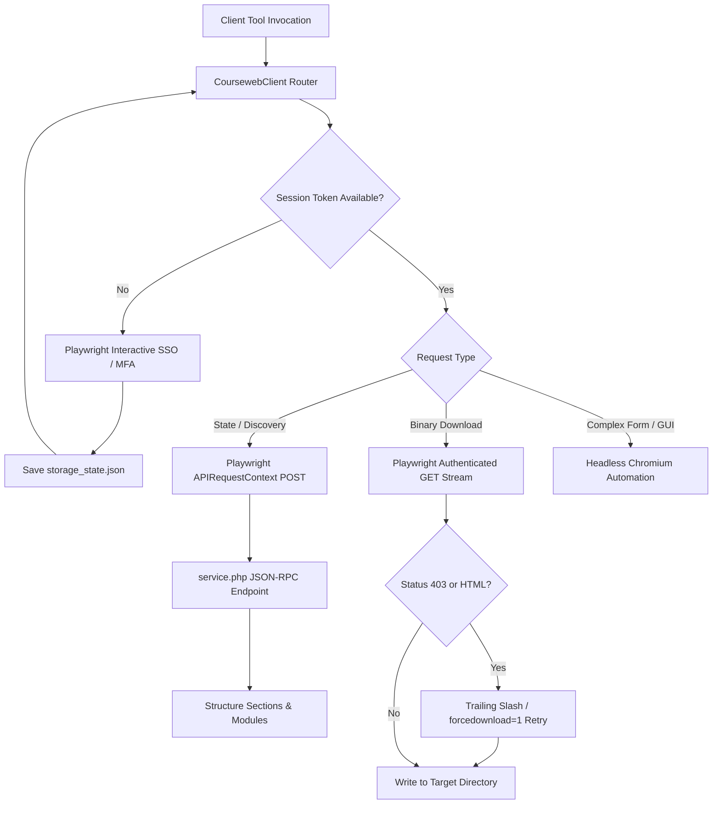

# Moodle Architecture and JSON-RPC Integration

This document outlines the internal architecture of SLIIT Courseweb and the engineering decisions behind the MCP server's dual-engine design.

---

## The Challenge with Modern Moodle Layouts

Modern Moodle installations (Moodle 4.x) frequently employ dynamic course presentation plugins, including:

- **`format_tiles` (Tiles Format)**: Course sections are shown as clickable card tiles.
- **`format_grid` (Grid Format)**: Course sections are displayed as an image-icon grid with modal lightboxes.

### The Problem with Static DOM Scraping

In traditional Moodle setups (e.g. `format_topics`), all sections (0 to N) are printed directly in the initial HTML as full `<ul>` and `<li>` lists.

However, in `format_tiles`:
1. Only Section 0 ("General") is populated in the initial HTML response.
2. Sections 1 through 12 are rendered as empty, hidden containers:
   ```html
   <li class="section course-section main moveablesection" style="display: none;" id="section-1" data-section="1" data-sectionid="93099"></li>
   ```
3. When a student clicks a tile in a browser, client-side JavaScript calls Moodle's internal AJAX services to fetch and render the section content on demand.

Traditional scrapers that inspect the DOM after `page.goto()` will only ever see Section 0, omitting all lecture slides, tutorials, and materials from Topic 1 onwards.

---

## The Solution: Native Moodle JSON-RPC Web Services

Rather than emulating browser clicks on each tile (which is slow, fragile, and prone to timeouts), the MCP server interacts directly with Moodle's native AJAX endpoints located at:

```
https://courseweb.sliit.lk/lib/ajax/service.php?sesskey=<SESSKEY>&info=<METHOD_NAME>
```

### 1. `core_courseformat_get_state`

Returns the full reactive state of the course, regardless of the active format plugin:

- **Endpoint**: `lib/ajax/service.php`
- **Method**: `core_courseformat_get_state`
- **Arguments**: `{"courseid": 9220}`
- **Payload**:
  - `section`: An array of all course sections with their IDs, numbers, and titles.
  - `cm`: An array of all Course Modules across the entire course with module types (`resource`, `folder`, `assign`, `quiz`, `url`, `feedback`, `label`).
- **Response Time**: ~250ms - 400ms.

### 2. `core_course_get_enrolled_courses_by_timeline_classification`

Fetches enrolled courses grouped by timeline or student preferences:

- **Classification Values**: `all`, `favourites`, `inprogress`, `past`, `future`.
- **Payload Includes**: `id`, `fullname`, `shortname`, `viewurl`, and `isfavourite` boolean.
- **Response Time**: ~300ms - 500ms.

### 3. `core_get_fragment`

Used in `format_tiles` courses to fetch the rendered HTML fragment of a specific section:

- **Component**: `format_tiles`
- **Callback**: `get_cm_list`
- **Arguments**: `[{"name": "sectionid", "value": 98840}]`
- **Usage**: Allows the server to parse embedded lecture recording links (e.g., Unistream), MS Teams links, and feedback forms that instructors embed in labels.

---

## Dual-Engine Architecture



---

## Web Application Firewall (WAF) Resilience

SLIIT Courseweb is protected by Imperva / Incapsula WAF. The MCP client incorporates several protective strategies:

1. **Session Cookie Propagation**: The client automatically carries forward `visid_incap_*` and `incap_ses_*` tokens received during authentication.
2. **Forcedownload Parameter**: Appends `forcedownload=1` on Moodle `pluginfile.php` endpoints to prevent inline PDF rendering in headless mode and ensure binary data transmission.
3. **Trailing Slash Fallback**: When Imperva flags direct `.sql` or unusual binary requests with a 403 status, the client applies a trailing-slash bypass query (`cleanUrl + '/?forcedownload=1'`).
4. **Content-Disposition RFC 5987 Support**: Correctly decodes UTF-8 encoded file names (e.g., `filename*=UTF-8''...`) ensuring special characters in lecture titles are preserved without corruption.
