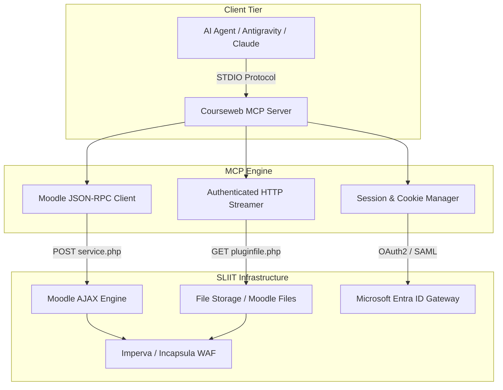
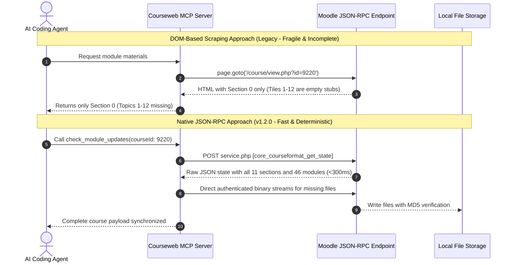

Deep architectural breakdown of SLIIT Courseweb (Moodle 4.x), dynamic course format rendering engines, native JSON-RPC web services, and Web Application Firewall (WAF) resilience strategies.

---

## Architecture Overview

SLIIT Courseweb (`courseweb.sliit.lk`) runs on Moodle 4.x, heavily customized with modern layout plugins, Microsoft Entra ID Single Sign-On, and Imperva / Incapsula Web Application Firewall protection.



---

## The Dynamic Layout Problem

Traditional web scrapers rely on static DOM traversal: they fetch a page with `page.goto()`, wait for network idle, and query elements using CSS selectors (e.g. `document.querySelectorAll('.section')`). 

While this works for legacy Moodle courses using `format_topics` or `format_weeks`, modern SLIIT courses increasingly employ **`format_tiles`** and **`format_grid`**.

### DOM Representation in `format_tiles`

In `format_tiles`, Moodle optimizes initial page weight by sending only Section 0 ("General") with full DOM content. Sections 1 through N are rendered as empty, hidden placeholders:

```html
<!-- Section 0: General (Rendered statically) -->
<li id="section-0" class="section course-section main" data-section="0">
  <div class="content">
    <ul class="section img-text">...</ul>
  </div>
</li>

<!-- Section 1 to N: Topics (Rendered as empty hidden stubs) -->
<li id="section-1" class="section course-section main moveablesection" style="display: none;" data-section="1" data-sectionid="93099"></li>
<li id="section-2" class="section course-section main moveablesection" style="display: none;" data-section="2" data-sectionid="93100"></li>
<li id="section-7" class="section course-section main moveablesection" style="display: none;" data-section="7" data-sectionid="98840"></li>
```

When a human user clicks tile 7 in a browser:
1. Moodle's client-side JavaScript issues an asynchronous `fetch` request to `service.php`.
2. The server responds with HTML fragments or module state.
3. The JavaScript dynamically injects the HTML into `<li id="section-7">` and changes `display: none` to `display: block`.

### Why DOM Scraping Fails

A standard DOM scraper inspecting `document.querySelectorAll('.section')` encounters:
- Empty inner HTML for Topics 1 to 12.
- 0 lecture slides, 0 tutorial exercises, and 0 assignment links discovered.
- Attempting to simulate clicks on every tile in headless Chromium introduces race conditions, animation delays, and frequent timeouts.

---

## Native Moodle JSON-RPC Web Services

To achieve sub-second execution speeds and 100% extraction accuracy, the SLIIT Courseweb MCP Server bypasses the frontend DOM entirely and communicates directly with Moodle's native AJAX JSON-RPC endpoints:

```http
POST /lib/ajax/service.php?sesskey=vzulPbp2tV&info=core_courseformat_get_state HTTP/1.1
Host: courseweb.sliit.lk
Content-Type: application/json
Cookie: MoodleSession=t8egaudc5h2b0t4v01ridbnvlc; ...

[
  {
    "index": 0,
    "methodname": "core_courseformat_get_state",
    "args": {
      "courseid": 9220
    }
  }
]
```

### JSON-RPC vs DOM Scraping Comparison



---

## Core RPC Methods Utilized

### 1. `core_courseformat_get_state`

Retrieves the complete internal state representation of the course format engine.

- **Request Payload**:
  ```json
  [
    {
      "index": 0,
      "methodname": "core_courseformat_get_state",
      "args": {
        "courseid": 9220
      }
    }
  ]
  ```

- **Response Payload Schema**:
  ```json
  [
    {
      "error": false,
      "data": "{\"course\":{\"id\":9220,\"format\":\"tiles\"},\"section\":[{\"id\":93098,\"number\":0,\"title\":\"General\"},{\"id\":98840,\"number\":7,\"title\":\"Topic 7 : Employee Training and Development\"}],\"cm\":[{\"id\":496142,\"name\":\"Lecture Slides\",\"modname\":\"resource\"}]}"
    }
  ]
  ```

### 2. `core_course_get_enrolled_courses_by_timeline_classification`

Queries enrolled courses categorized by timeline status without traversing the dashboard UI.

- **Request Arguments**:
  - `classification`: `"all"`, `"favourites"`, `"inprogress"`, `"past"`, or `"future"`.
  - `limit`: `0` (unlimited).
  - `offset`: `0`.
  - `sort`: `"fullname asc"`.

- **Response Payload**:
  ```json
  [
    {
      "error": false,
      "data": {
        "courses": [
          {
            "id": 9220,
            "fullname": "BM1045 - Human Resources Management [2026/JUL]",
            "shortname": "BM1045_2026_7_1",
            "isfavourite": true,
            "startdate": 1784511480,
            "enddate": 1793583480
          }
        ],
        "nextoffset": 6
      }
    }
  ]
  ```

### 3. `core_get_fragment`

Extracts rendered HTML fragments for specific components, such as `mod_label` embedded activities containing MS Teams meeting links, Zoom URLs, and Unistream video lecture streams.

- **Request Arguments**:
  - `component`: `"format_tiles"`
  - `callback`: `"get_cm_list"`
  - `args`: `[{"name": "sectionid", "value": 98840}]`

---

## Web Application Firewall (WAF) Resilience

SLIIT Courseweb is protected by Imperva Incapsula WAF. Automated requests that fail to mimic authentic browser sessions risk receiving HTTP 403 Forbidden or captcha challenges. The MCP server integrates four defensive layers:

### 1. Incapsula Session Token Propagation

When establishing an authenticated session, the server extracts both Moodle cookies and Imperva security tokens:
- `visid_incap_*`: Persistent visitor identification.
- `incap_ses_*`: Active session validation.
- `___utmvc`: Dynamic behavioral verification token.

These cookies are stored in `storage_state.json` and attached to all outgoing Playwright `APIRequestContext` instances.

### 2. Forcedownload Parameter Enforcement

When downloading binary resources via Moodle's `pluginfile.php` service, Chromium's built-in PDF viewer intercepts PDF streams and renders them visually in headless mode. Appending `forcedownload=1` instructs Moodle to deliver the file with `Content-Disposition: attachment`, forcing direct byte-stream transmission.

### 3. Trailing Slash WAF Bypass

Imperva WAF inspection rules occasionally block automated requests to URLs ending with certain resource extensions (e.g. `.sql` schema files or `.zip` archives). When an initial download returns HTTP 403, the server transparently retries with an appended trailing slash:

$$\text{Target URL} \longrightarrow \text{Target URL} + \text{"/?forcedownload=1"}$$

### 4. RFC 5987 Filename Decoding

Moodle filenames containing non-ASCII Unicode characters or spaces are encoded according to RFC 5987:

```http
Content-Disposition: attachment; filename*=UTF-8''Tutorial%2001%20%28Week%2001%29.pdf
```

The MCP download engine parses both standard `filename="name"` and internationalized `filename*=UTF-8''encoded_name` directives, preventing character corruption when saving files locally.
