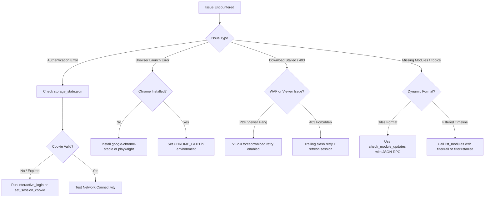

Diagnostic guides, resolution workflows, and answers to frequently asked questions for the SLIIT Courseweb MCP Server.

---

## Diagnostic Flowchart

Use this decision tree to pinpoint and resolve connection or download issues:



---

## Common Issues & Solutions

### 1. "Session expired and auto-login failed"

#### Symptom
Calls to `list_modules`, `check_module_updates`, or `get_deadlines` return an error indicating authentication failed, or redirect back to `/login/index.php`.

#### Cause
Moodle session tokens (`MoodleSession`) expire automatically after 14 to 30 days of inactivity, or whenever an administrative password reset or global logout occurs.

#### Resolution
- **Interactive Desktop Workflow**:
  Call the `interactive_login` tool. Playwright will launch a visible Chromium window directing you to Microsoft SSO. Complete MFA and the session token will update automatically.
- **Headless / Server Workflow**:
  1. Open [courseweb.sliit.lk](https://courseweb.sliit.lk) in your desktop browser.
  2. Open Developer Tools (`F12` or `Ctrl+Shift+I` / `Cmd+Option+I`).
  3. Navigate to **Application** > **Cookies** > `https://courseweb.sliit.lk`.
  4. Copy the value of the `MoodleSession` cookie.
  5. Call the `set_session_cookie` tool with the copied value:
     ```json
     {
       "value": "<YOUR_NEW_COOKIE_VALUE>"
     }
     ```

---

### 2. "Executable doesn't exist at ~/.cache/ms-playwright/..."

#### Symptom
The server fails to start or crashes upon tool invocation with a message indicating missing browser binaries.

#### Cause
Playwright was installed using `npm install` without downloading the bundled browser binaries, or the system path to Google Chrome is unresolvable.

#### Resolution
The MCP server checks system paths in the following priority order:
1. The `CHROME_PATH` environment variable.
2. `/usr/bin/google-chrome`
3. `/usr/bin/google-chrome-stable`
4. `/Applications/Google Chrome.app/Contents/MacOS/Google Chrome` (macOS)
5. `C:\Program Files\Google\Chrome\Application\chrome.exe` (Windows)

To resolve:
- **Option A (Recommended for Linux)**: Install the official Google Chrome package:
  ```bash
  sudo apt-get update && sudo apt-get install -y google-chrome-stable
  ```
- **Option B**: Download Playwright's bundled Chromium:
  ```bash
  npx playwright install chromium
  ```
- **Option C**: Set an explicit binary path in your `.env` file:
  ```env
  CHROME_PATH=/usr/bin/chromium
  ```

---

### 3. "Timeout 30000ms exceeded while waiting for event download"

#### Symptom
When calling `download_file` or `sync_module`, downloading a PDF file hangs for 30 seconds and then fails with a timeout exception.

#### Cause
By default, Chromium opens PDF documents inside its internal PDF viewer plugin rather than triggering a native browser download event.

#### Resolution
In version 1.2.0, the server enforces:
1. Direct authenticated HTTP streaming using Playwright's `APIRequestContext`.
2. Automatic parameter injection (`forcedownload=1`) on all `mod/resource` and `pluginfile.php` URLs.
3. Fallback to direct stream retrieval if a browser download event is not emitted within 3 seconds.

Ensure your installation is updated to `v1.2.0` or higher:
```bash
git pull origin main
npm run build
```

---

### 4. "HTTP 403 Forbidden" during bulk file downloads

#### Symptom
Individual files (such as `.sql`, `.zip`, or `.rar` attachments) fail to download with an HTTP 403 status code while other files succeed.

#### Cause
Imperva / Incapsula WAF rules flag automated requests with non-standard file extensions or missing browser request headers.

#### Resolution
The server's download pipeline includes automatic trailing-slash query normalization and Incapsula cookie forwarding. If an individual file consistently fails:
1. Verify that your `storage_state.json` contains active `visid_incap_*` cookies.
2. If cookies are missing, trigger `interactive_login` to capture fresh Incapsula security tokens.

---

### 5. Why are some courses missing from `list_modules`?

#### Symptom
Enrolled modules from previous semesters or specific future modules do not show up in the output of `list_modules`.

#### Cause
SLIIT Courseweb groups courses into timeline categories (e.g. In Progress, Past, Future, Removed from Display). By default, `list_modules` queries all timeline categories, but certain courses may be archived or classified under past terms.

#### Resolution
Use timeline filters when calling `list_modules`:
- `list_modules(filter: "starred")`: Returns only your marked favourite courses.
- `list_modules(filter: "inprogress")`: Returns courses for the active academic semester.
- `list_modules(filter: "past")`: Returns archived courses from completed terms.
- `list_modules(filter: "all")`: Returns the entire enrolled catalog.

---

## Frequently Asked Questions (FAQ)

### Security and Privacy

#### Where are my credentials and session tokens stored?
All authentication states are saved locally in `storage_state.json` at the root of the project (or the directory specified by `COURSEWEB_SESSION_PATH`). This file is strictly excluded from version control via `.gitignore`. The MCP server communicates exclusively with `courseweb.sliit.lk` and Microsoft SSO endpoints; no telemetry or data is transmitted to external third-party services.

#### Does the server require my university password?
No. You do not need to store your university password in plain text. You can authenticate either via interactive browser SSO (`interactive_login`) or by copying your session cookie (`set_session_cookie`).

### Performance & Scalability

#### How fast is the synchronization pipeline?
- Module discovery (`check_module_updates`): Sub-300ms using native Moodle JSON-RPC calls.
- Bulk sync (`sync_module`): Downloads 40+ files (50 MB) in approximately 10 to 15 seconds, depending on your internet connection speed.
- Files that already exist on disk with identical size and hash are skipped instantly.

#### Can I run this server inside a headless Docker container?
Yes. Follow the Docker configuration guide in the **[[Client Configuration|Client-Configuration]]** documentation. Ensure you install Chromium and the required font packages (`fonts-liberation`, `libnss3`, `xdg-utils`) in your container image.
